# 4. Results

All numbers below come from `results/*.json` written by `python experiments/run_all.py`. The scenarios are generic. The beamforming baseline is $N = 16$, $d = \lambda/2$, target at broadside with per-element SNR 0 dB, jammers at $+35^\circ$ (JNR 40 dB) and $-42^\circ$ (JNR 30 dB), unit noise power. Radar parameters are listed in [02_numerical_method.md §2.4](02_numerical_method.md#24-waveform-delay-and-doppler-discretization). Figures are numbered continuously across the repository. Captions with the details are in [07_figure_index.md](07_figure_index.md), and the verification status of each quantity is in [03_verification_validation.md](03_verification_validation.md).

## 4.1 ULA model

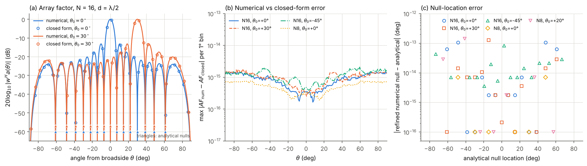

**Figure 1.** ULA array factor: numerical response vs closed form, and null-location errors.

The numerical array factor matches (A.3) to $\le 2.1\times10^{-15}$ for all five cases ($N = 8, 16$; steering $0^\circ$ to $-45^\circ$). Nulls lie where (A.4) predicts to $\le 1.4\times10^{-13}$ deg. For $N=16$ the peak sidelobe level is $-13.147$ dB at every steering angle ($N = 8$: $-12.797$ dB; large-$N$ limit $-13.261$ dB). Half-power beamwidths are 6.359°, 7.349° and 9.025° at 0°, 30° and −45°, 0.2–0.6 % wider than the $0.886\lambda/(Nd\cos\theta_0)$ approximation.

## 4.2 Conventional vs MVDR beamforming

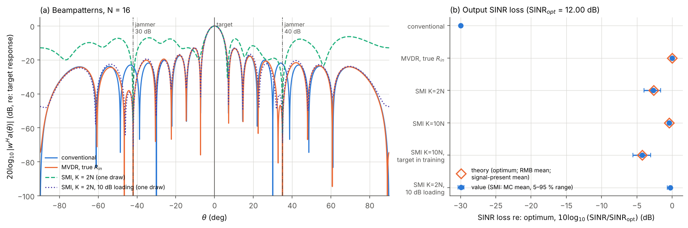

**Figure 2.** Beampatterns and output-SINR loss for conventional, clairvoyant MVDR and sample-matrix MVDR.

| Beamformer | target gain (dB) | jammer 35° re: target (dB) | jammer −42° re: target (dB) | output SINR (dB) | loss re: optimum (dB) |
|---|---|---|---|---|---|
| conventional | 0 | −22.3 | −23.8 | −17.99 | −29.99 |
| MVDR, true $\mathbf R_{in}$ | 0 (±2e-15) | −126.4 | −107.9 | 12.00 | 0.00 |
| SMI, K = 2N, signal-free (MC mean, 2000 trials) | 0 | −66.2 (median) | −56.4 | 9.34 | −2.66 (RMB −2.63) |
| SMI, K = 10N, signal-free | 0 | −75.3 | −65.1 | 11.57 | −0.42 (RMB −0.42) |
| SMI, K = 10N, target in training | 0 | −62.9 | −53.2 | 7.77 | −4.23 (theory −4.25) |
| SMI, K = 2N, 10 dB loading | 0 | −68.2 | −58.3 | 11.71 | −0.29 |

The optimum SINR is 12.00 dB, 0.04 dB below the jammer-free array SNR of 12.04 dB, because the jammers remove two of 16 degrees of freedom. With these sidelobe jammers the conventional beamformer is jammer-limited: it loses 30 dB. A clairvoyant MVDR places nulls deeper than 100 dB; this is an idealized numerical value for an exactly known covariance, not a hardware rejection figure. With sample covariances the finite training set limits the nulls to 55–75 dB, and the mean SINR losses are consistent with the Reed–Mallett–Brennan prediction [4]; the SINR is limited by the misadjusted noise subspace rather than by jammer leakage. With $K = 2N$ unloaded, the elevated sidelobes in Figure 2(a) show the same effect.

## 4.3 Snapshot sensitivity and covariance conditioning

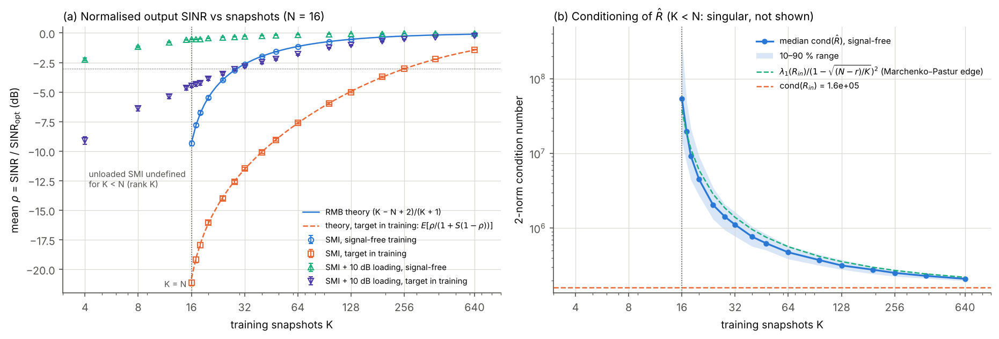

**Figure 3.** Mean normalized output SINR against the number of training snapshots, and the condition number of the sample covariance.

| K | RMB theory (dB) | SMI signal-free | SMI target in training (theory) | loaded 10 dB, signal-free | loaded 10 dB, target in training |
|---|---|---|---|---|---|
| 8 (=N/2) | undefined | singular (600/600) | singular | −1.17 | −6.39 |
| 16 (=N) | −9.29 | −9.35 | −21.12 (−20.77) | −0.54 | −4.46 |
| 32 (=2N) | −2.63 | −2.66 | −11.48 (−11.53) | −0.28 | −2.83 |
| 64 | −1.14 | −1.14 | −7.62 (−7.63) | −0.14 | −1.81 |
| 128 | −0.54 | −0.54 | −5.01 (−4.95) | −0.07 | −1.03 |
| 640 (=40N) | −0.10 | −0.10 | −1.43 (−1.45) | −0.01 | −0.23 |

* The smallest $K$ in the grid with mean loss ≤ 3 dB:
  * unloaded, signal-free: 32 (RMB [4]: $2N-3 = 29$);
  * unloaded, target in training: 384;
  * 10 dB loading, signal-free: 4;
  * 10 dB loading, target in training: 32.
* With the target in the training data, an SINR$_{\rm opt}$ of 12 dB raises the snapshot requirement by about an order of magnitude. This is the behavior predicted by (C.2).
* Unloaded SMI is undefined for $K<N$. With loading it works down to $K = 4 = 2r$, where $r = 2$ is the number of jammers.
* The median condition number of $\hat{\mathbf R}$ is $5.4\times10^7$ at $K = N$, about 340 times that of the true covariance ($1.6\times10^5$). It falls toward the true value as $K$ grows and follows the Marchenko–Pastur lower-edge estimate [18] within a factor 0.72–1.42.

## 4.4 Diagonal-loading sensitivity

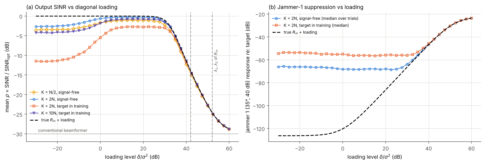

**Figure 4.** Mean normalized output SINR and jammer-1 response against the loading level.

| Case | best loading (dB re: σ²) | best mean ρ (dB) | loading within 1 dB of best | ρ at −30 dB | ρ at +60 dB |
|---|---|---|---|---|---|
| K = 8, signal-free | 12.5 | −1.06 | 0 … 27.5 | −3.57 | −28.80 |
| K = 32, signal-free | 17.5 | −0.27 | −5 … 27.5 | −2.64 | −28.78 |
| K = 32, target in training | 22.5 | −2.71 | 5 … 30 | −11.49 | −28.80 |
| K = 160, target in training | 17.5 | −0.74 | 2.5 … 30 | −4.24 | −28.80 |

As expected from diagonal-loading theory [5, 7], loading is beneficial in this scenario over a wide plateau, from roughly the noise level up to 27.5–30 dB, i.e. 12–15 dB below the second interference eigenvalue (42 dB). Beyond about 30 dB it removes jammer suppression: the clairvoyant loaded beamformer loses 1.0 dB at +30 dB, 11.4 dB at +40 dB and 22.7 dB at +50 dB, and all estimates converge toward the conventional value (−29.99 dB). The plateau is scenario dependent. It is bounded below by the spread of the noise eigenvalues and above by the weakest interference eigenvalue, so a fixed loading level is not safe for weaker jammers. At very small loading with $K = 8 < N$, the 3.6 dB loss reflects the projection onto the 8-dimensional data subspace (§C.3), not a failure.

## 4.5 Steering mismatch and self-nulling

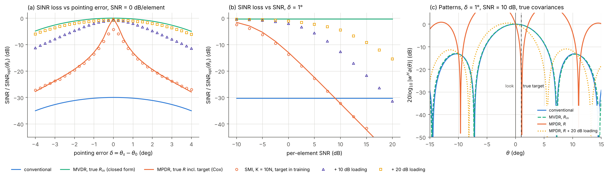

**Figure 5.** SINR loss against pointing error and against SNR, and beampatterns for a 1° pointing error.

SINR loss (dB, re: the optimum for the true direction). Half-power beamwidth 6.36°.

| | conventional | MVDR, $\mathbf R_{in}$ | MPDR, $\mathbf R$ (Cox) | SMI K=10N, target in training | + 10 dB loading | + 20 dB loading |
|---|---|---|---|---|---|---|
| δ = 1°, SNR 0 dB | −30.26 | −0.28 | −13.01 | −13.59 | −2.07 | −1.11 |
| δ = 2.5°, SNR 0 dB | −31.81 | −1.82 | −21.76 | −21.95 | −6.35 | −2.81 |
| δ = 1°, SNR −10 dB | −30.26 | −0.28 | −1.61 | −2.41 | −0.51 | −0.43 |
| δ = 1°, SNR +10 dB | −30.26 | −0.28 | −32.31 | −32.26 | −12.69 | −4.53 |
| δ = 1°, SNR +20 dB | −30.26 | −0.28 | −52.26 | −50.31 | −31.40 | −15.43 |

A pointing error of 1°, one sixth of the beamwidth, costs only 0.28 dB when the target is absent from the covariance. When the target is present, the same error costs 13 dB at SNR 0 dB and 32 dB at SNR 10 dB. The loss grows by about 20 dB per 10 dB of SNR, as (C.3) predicts for $S\gg1$, consistent with the known mismatch sensitivity of optimum array processors [6]. With the clairvoyant MPDR at SNR 10 dB and δ = 1°, the response toward the true target is −21.1 dB. Figure 5(c) shows the pattern notch at the target and sidelobes raised to about 0 dB. Loading reduces self-nulling substantially at moderate SNR (20 dB loading: −4.5 dB at SNR 10 dB). At SNR 20 dB even 20 dB loading leaves a 15 dB loss.

## 4.6 Jammer angle and JNR

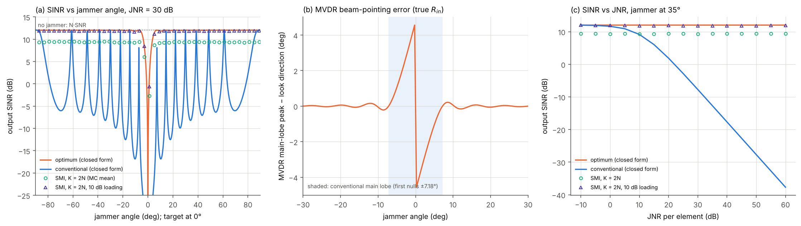

**Figure 6.** Output SINR against jammer angle, MVDR beam-pointing error, and output SINR against JNR.

* **Jammer angle** (JNR 30 dB, single jammer). The optimum SINR (B.7) is within 0.2 dB of the jammer-free 12.04 dB for jammers more than 10.75° from the target. It drops to 10.4 dB at 4° and 5.7 dB at 2°. The conventional SINR follows the sidelobe structure. Beyond 8° it ranges from −16.9 dB (jammer on a sidelobe peak) to +12.0 dB (jammer on a pattern null). Inside the main lobe it falls below −25 dB. SMI with $K=2N$ stays 2.5–2.75 dB below the optimum at all 45 sampled angles, as the RMB law predicts [4].
* **Beam pointing.** With the jammer outside the conventional main lobe (first nulls ±7.18°), the MVDR main-lobe peak moves by at most 0.21°. With the jammer inside the main lobe, the pattern maximum is pushed away from the jammer by up to 4.6° (jammer at −0.25°). The distortionless constraint still holds at the look direction, but the look direction is no longer the pattern maximum.
* **JNR** (jammer at 35°). The conventional SINR falls 1 dB per dB of JNR above about 10 dB (−37.7 dB at JNR 60 dB). The optimum stays at 12.02 dB. SMI ($K = 2N$) stays 2.56–2.72 dB below the optimum while cond($\mathbf R_{in}$) ranges from 2.6 to $1.6\times10^7$. 10 dB loading recovers to within 0.2 dB of the optimum at every JNR tested.

## 4.7 Pulse compression and range resolution

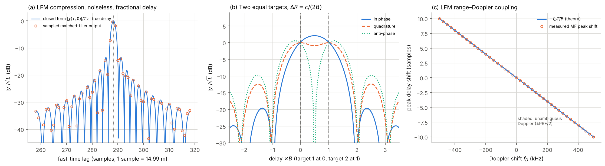

**Figure 7.** LFM matched-filter output against the closed form, two-target resolution, and range–Doppler coupling.

* The sampled matched-filter output ($f_s = 2B$) matches the continuous LFM autocorrelation (D.5) to 0.007 of the peak near the main lobe.
* The measured first null is at $\tau B = 1.025$ (closed form 1.021). The −3 dB width is $0.90/B$.
* White noise keeps unit variance through the matched filter (0.9996). The SNR gain is $L = 100$: measured output SNR 10.04 ± 0.07 (linear) for −10 dB input, against 10.00 expected.
* Two equal targets at the nominal $c/2B = 29.98$ m separation [10] are resolved with a −0.9 dB dip when in quadrature. They are not resolved when in phase, which requires about $1.5\,c/2B$ (−2.1 dB dip). Anti-phase targets are resolved even at $0.75\,c/2B$.
* The range–Doppler coupling shift matches the LFM prediction $-f_D T/B$ [9] to 0.015 samples over ±500 kHz. At the largest unambiguous Doppler (PRF/2 = 5 kHz) the coupling bias is 1.5 m, 0.1 of a range sample.

## 4.8 Range–Doppler map

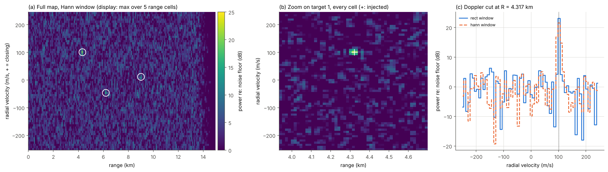

**Figure 8.** Simulated range–Doppler map with three targets.

| Target | true (R, v) | estimated, parabolic (R, v) | error (m, m/s) | peak SNR (dB) |
|---|---|---|---|---|
| 1 | 4321.7 m, +101.3 m/s | 4319.5 m, +101.0 m/s | −2.2, −0.30 | 21.6 |
| 2 | 6200.0 m, −45.6 m/s | 6201.4 m, −45.3 m/s | +1.4, +0.34 | 15.9 |
| 3 | 9007.4 m, +12.2 m/s | 8996.2 m, +8.8 m/s | −11.2, −3.41 | 12.4 |

These are values from one CPI with a Hann window. The sign convention holds: closing targets appear at positive velocity. All estimates are within one resolution cell. Errors grow as SNR falls (§4.9).

## 4.9 FFT binning, straddle and scalloping

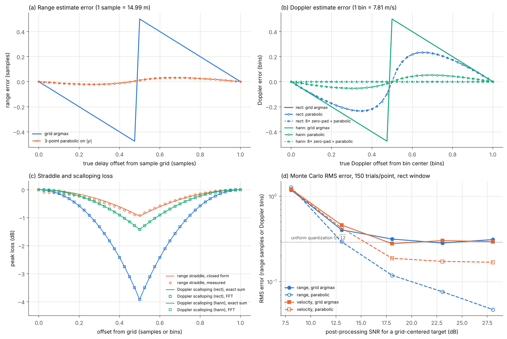

**Figure 9.** Grid and interpolated estimation errors, straddle and scalloping losses, and Monte Carlo RMS error against SNR.

| Quantity | grid argmax | 3-point parabolic | 8× zero-pad + parabolic |
|---|---|---|---|
| range, max error (noiseless) | 0.50 sample = 7.49 m | 0.032 sample = 0.48 m | — |
| Doppler, max error, rect | 0.50 bin = 3.90 m/s | 0.234 bin | 1.6e-4 bin |
| Doppler, max error, Hann | 0.50 bin | 0.053 bin | 8.5e-5 bin |
| worst-case loss | range straddle −0.91 dB; Doppler scalloping −3.92 dB (rect), −1.42 dB (Hann) | | |

The worst-case scalloping losses, 3.92 dB (rectangular) and 1.42 dB (Hann) at half a bin, follow standard window behavior [11]. With noise (rectangular window, 150 trials per point), the parabolic estimator reaches 0.71 m RMS in range at 28 dB post-processing SNR. In velocity it saturates at 1.32 m/s, the interpolation bias of the rectangular window. The grid estimator stays at the quantization floor (4.3 m, 2.3 m/s). Interpolation helps range much more than Doppler for a rectangular window. The rectangular window's narrower Doppler peak makes a three-point parabola a poor model of its shape.

## 4.10 CA-CFAR threshold behavior

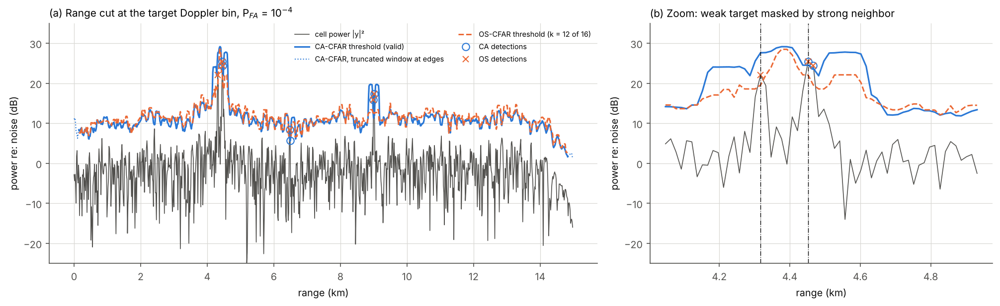

**Figure 10.** CA- and OS-CFAR thresholds on one range cut, including a weak target next to a strong one.

The −15 dB target (cell power 22.0 dB above noise) is masked under CA-CFAR because the −10 dB neighbor 9 cells away raises the CA threshold to 27.6 dB. OS-CFAR ($k = 12$ of 16), which is less affected by a few contaminated training cells [13], sets 19.5 dB and detects it. Both detectors also flag one noise cell at 6.5 km. This is a single realization. The geometry was chosen from a saved 20-seed scan (`results/cfar_masking_seed_scan.json`), in which CA-CFAR detected the weak target in 0/20 realizations and OS-CFAR in 20/20.

## 4.11 False-alarm verification

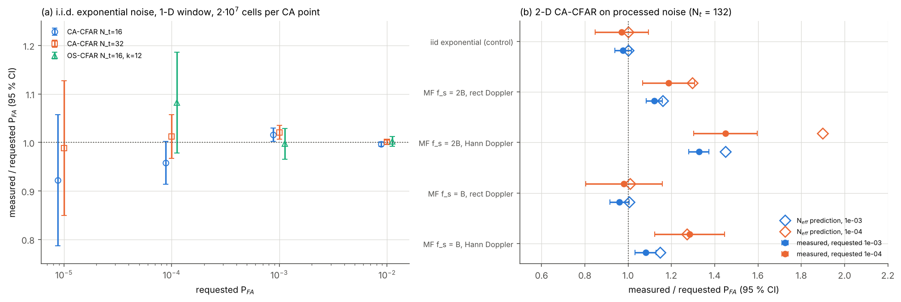

**Figure 11.** Measured against requested false-alarm probability, in i.i.d. noise and in processed noise.

* **i.i.d. exponential noise.** CA-CFAR ($N_t = 16, 32$) and OS-CFAR ($N_t = 16$, $k=12$) give measured/requested ratios between 0.92 and 1.08 over $10^{-2}$ to $10^{-5}$, consistent with the nominal values of (E.5) [12] and (E.8) [13]. The full table is in [03 §3.5](03_verification_validation.md#35-cfar-exact-and-statistical).
* **Noise processed by the actual chain** (matched filter at $f_s = 2B$, Doppler FFT). The nominal CA-CFAR threshold under-protects. Measured/requested is 1.12 ± 0.04 (rectangular window) and 1.33 ± 0.05 (Hann) at $10^{-3}$, rising to 1.19 ± 0.12 and 1.45 ± 0.15 at $10^{-4}$. At $f_s = B$ with a rectangular window the ratio returns to 0.96–0.98. The cause is correlation between training cells (§3.6).

## 4.12 Probability of detection

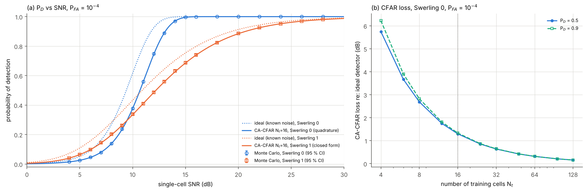

**Figure 12.** Probability of detection against SNR for CA-CFAR and the ideal detector, and CFAR loss against the number of training cells.

$P_{FA} = 10^{-4}$, $N_t = 16$. All 38 Monte Carlo points (Swerling 0 and 1) agree with theory within 95 % intervals.

| | ideal, Swerling 0 | CA-16, Swerling 0 | ideal, Swerling 1 | CA-16, Swerling 1 |
|---|---|---|---|---|
| SNR for $P_D = 0.5$ (dB) | 9.40 | 10.69 | 10.89 | 12.20 |
| SNR for $P_D = 0.9$ (dB) | 11.75 | 13.08 | 19.37 | 20.67 |

CFAR loss with $N_t=16$ is 1.30 dB at $P_D=0.5$ and 1.33 dB at $P_D = 0.9$, about the same for both target models. It falls to 0.64 dB at $N_t = 32$ and 0.16 dB at $N_t = 128$, and rises to 5.7 dB at $N_t = 4$. Target fluctuation (Swerling 1 vs 0 [15]) costs 1.5 dB at $P_D = 0.5$ and 7.6 dB at $P_D = 0.9$. The ideal Swerling-0 values agree with Albersheim's approximation [16] to within 0.075 dB (03 §3.5).

## 4.13 Integrated array + radar example

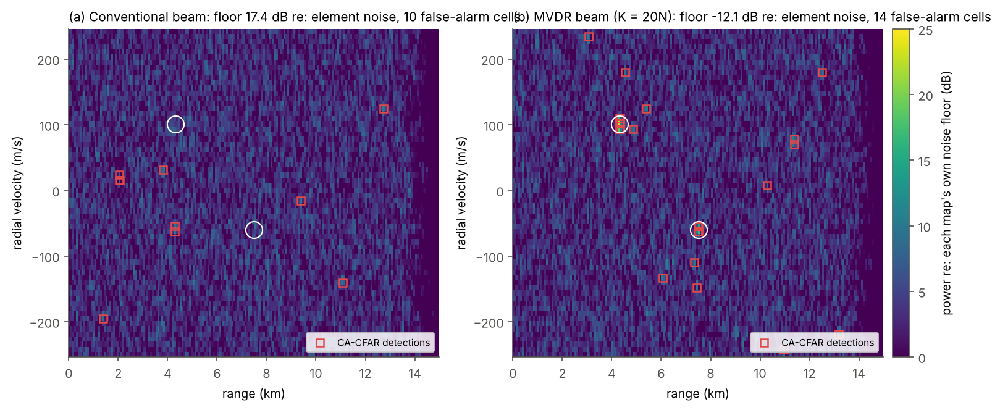

**Figure 13.** Range–Doppler maps after conventional and MVDR beamforming of a 16-element array cube with a noise jammer.

$N = 16$, targets at 0° and 2° with per-element SNR −25 and −30 dB, noise jammer at 35° (JNR 40 dB per element). MVDR uses $K = 20N$ random samples from the data cube.

| | beam-output I+N power (dB re: element noise) | measured map floor (dB) | array SINR per unit SNR, target 1 (dB) | targets detected | false-alarm cells (clusters) |
|---|---|---|---|---|---|
| conventional | 17.7 | 17.4 | −17.7 | 0 of 2 | 10 (7) |
| MVDR | −11.9 | −12.1 | 11.9 (optimum 12.0) | 2 of 2 | 14 (12) |

The expected false-alarm count is 5.6 at nominal $P_{FA}$, or 8.2 including the measured inflation of §4.11. This is a single realization.

## 4.14 Summary of findings

1. The array model, beamformer closed forms, matched filter and CFAR threshold formulas are reproduced to floating-point precision where an exact result exists.
2. Finite-sample MVDR follows the RMB law [4]. When the target is present in the training data, it follows (C.2), derived here, which explains an order-of-magnitude increase in the snapshot requirement at 12 dB SINR.
3. MVDR performs poorly in these regimes:
   * $K < N$ without loading (undefined);
   * $K \approx N$ (−9.3 dB);
   * target present in the training data together with even a fraction-of-a-beamwidth pointing error (−13 dB at SNR 0, −52 dB at SNR 20 for 1°);
   * jammers inside the main lobe, where no linear beamformer can help;
   * diagonal loading comparable to the interference eigenvalues.
4. FFT binning limits unaided range and Doppler accuracy to $\Delta/\sqrt{12}$ RMS and costs up to 0.9 dB (range) and 3.9 dB (Doppler, rectangular) of peak SNR. Parabolic interpolation recovers most of the range error but not the rectangular-window Doppler error.
5. CA-CFAR meets its nominal $P_{FA}$ in i.i.d. noise. On noise that has gone through the matched filter (2× oversampled) and a Hann Doppler window, it exceeds the nominal rate by up to about 45 % at $10^{-4}$.
